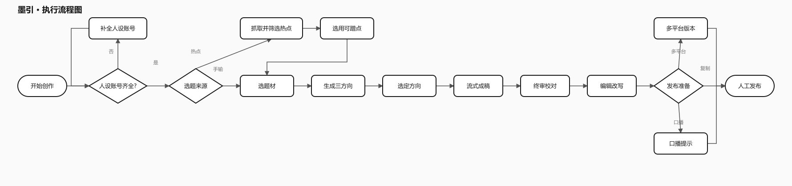

# 墨引

面向个人自媒体作者的写稿流水线。用人设和账号，把「选题 → 方向 → 成稿 → 校对 → 多平台改写 / 口播」串成一条可以准备发布的流程。



## 五分钟试用

需要 Node.js 20.9 或更高版本。

```bash
npm install
```

复制环境变量文件。

Windows：

```powershell
copy .env.example .env.local
```

macOS / Linux：

```bash
cp .env.example .env.local
```

打开 `.env.local`，写成下面这样。`SESSION_SECRET` 换成你自己的随机字符串，至少 16 位。

```
LLM_MOCK=1
SESSION_SECRET=换成至少16位的随机字符串
```

启动后打开 [http://localhost:3000](http://localhost:3000)。

```bash
npm run dev
```

`LLM_MOCK=1` 时，三个方向和成稿用的是项目里的本地示例，不会请求大模型。页面上会提示当前是演示模式。这条路径用来把流程点通。

要按题材真实生成，在 `.env.local` 填写 `LLM_API_KEY`，把 `LLM_MOCK` 设为 `0`，然后重新运行 `npm run dev`。密钥只放在 `.env.local`，这个文件不会提交。

## 建议走一遍

打开后可以直接以游客试用。注册登录后，可以认领游客期间写的稿。

1. 先填个人人设，再建一个账号。职业、行业、性格和发布平台没填齐时，不能开写。
2. 选题可以手写题材，也可以从热点里选一条。
3. 提交后先看三个方向，选一个生成正文。需要的话再改字，或对选中的段落做局部改写。
4. 做终审校对。语言问题可以一键替换；调性、合规和事实类风险只提示，不改正文。最后自己复制到平台发布。墨引不代发。

## 这个项目做了什么

个人项目，从产品定义做到可运行的 Demo。给个人自媒体作者一条写稿流水线：先定「谁在写、这个号发什么」，再走完选题、方向、成稿和发布前检查。

- **人设和账号**：个人人设写年龄、职业、行业、性格，各账号共用。账号再写清定位、要解决的问题、读者和发布平台。关键信息没填齐，不能开写。
- **选题**：可以手写题材，也可以从六个热榜里筛适合这个号的点。热点只按页面给出的概要来写，对不上账号的不推荐。不蹭热点时，按账号定位给出常规选题。
- **方向和成稿**：一个题材先给出三个不同切入。选定后生成完整稿，包含标题、封面文案、正文、结尾互动和标签。
- **改稿**：成稿后可以改字，或选中一段做扩写、缩写、改语气。满意的段落可以收成语气样本，下次写稿更接近本人的口吻。
- **校对**：错字、语句、重复和前后矛盾可以一键替换。账号调性、平台调性、合规和事实类风险只提示，由作者决定改不改。
- **发布准备**：同一篇稿可以改成其他平台的版本，也可以生成口播提示，标出语气、重音和停顿。复制后自行发布。

## 技术栈与边界

- Next.js、React、本地 SQLite
- 模型接口兼容 OpenAI 协议和 Anthropic 协议
- 首次启动会在项目目录生成 `data/` 数据库，这个目录不进入仓库

发布由作者自己完成。当前没有各平台一键外发、支付，也没有多人协作。
